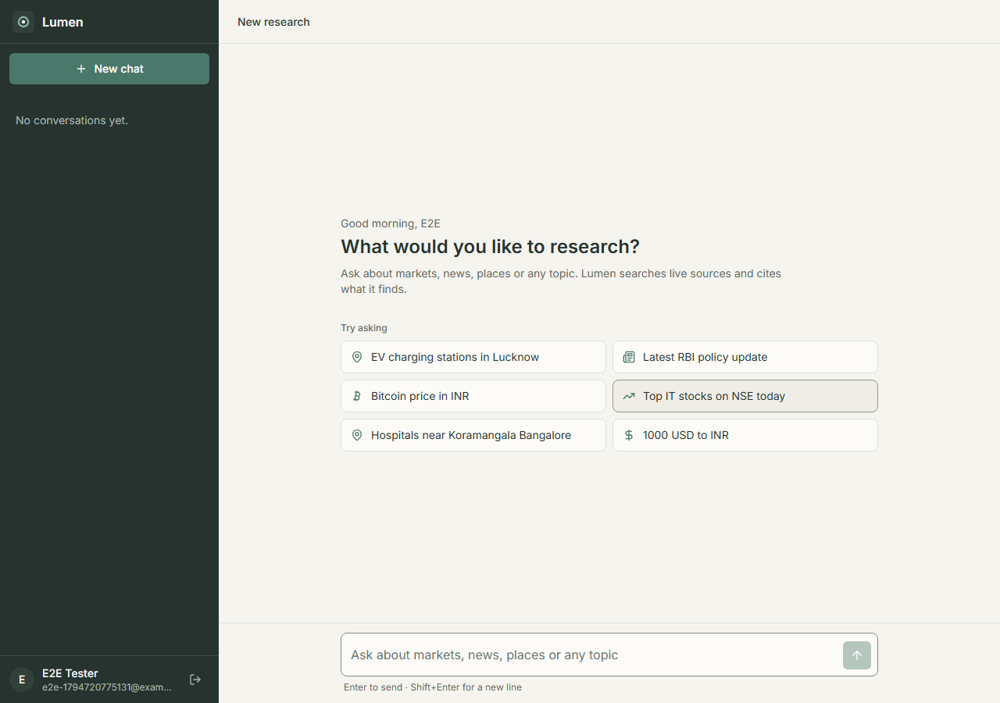
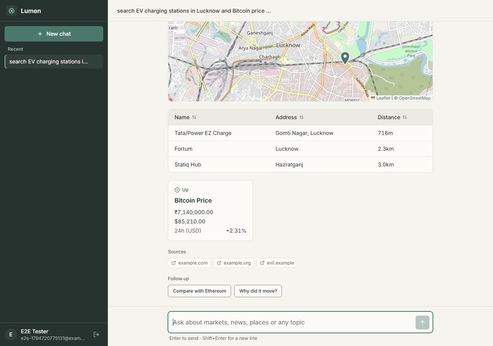

# Lumen — Deep Research Platform

A full-stack research assistant. Sign in, ask a question, watch the agent work, and get a cited answer made of structured
blocks (markdown, tables, maps, metric cards). React frontend, FastAPI backend, PostgreSQL, and a separate Python research agent
(Deep Agents / LangGraph) with eight tools, streaming everything over Server-Sent Events.

```
┌────────────┐  HTTPS+SSE   ┌─────────────────────┐  SSE + X-Internal-Token  ┌──────────────────────┐
│ React UI   │◄────────────►│ FastAPI backend     │◄────────────────────────►│ Research agent       │
│ Vite / TS  │ HttpOnly ck. │ auth · DB · SSE     │   (not published)        │ Deep Agents · 8 tools│
└────────────┘              └──────────┬──────────┘                          └───────────┬──────────┘
                                       ▼                                                 ▼
                                 PostgreSQL 16                                    Redis 7 (tool cache)
```

Documentation: [`PRD.md`](PRD.md) · [`ARCHITECTURE.md`](ARCHITECTURE.md) · [`research-agent/ARCHITECTURE.md`](research-agent/ARCHITECTURE.md) ·
[`DESIGN.md`](DESIGN.md) · [`SECURITY_REVIEW.md`](SECURITY_REVIEW.md) · [`TEST_PLAN.md`](TEST_PLAN.md) · [`TASKS.md`](TASKS.md) · [`AGENTS.md`](AGENTS.md)

Implemented and documented: [`docs/FRONTEND_TESTING_PLAN.md`](docs/FRONTEND_TESTING_PLAN.md) · [`docs/COOKIE_AUTH_MIGRATION_PLAN.md`](docs/COOKIE_AUTH_MIGRATION_PLAN.md).
Operations and plans: [`docs/DB_CREDENTIALS.md`](docs/DB_CREDENTIALS.md) · [`docs/AWS_SECRETS_PLAN.md`](docs/AWS_SECRETS_PLAN.md) (a plan; no AWS resources exist).

## What it does

- **Cited research answers.** The agent plans, calls tools, reads sources and returns structured blocks: markdown, sortable tables, maps, metric cards, plus Sources and follow-up suggestions. Unknown block types fall back to a JSON view instead of breaking the page.
- **Live progress.** Every tool call streams to the browser as a checkpoint over Server-Sent Events, with Stop, error and retry states.
- **Eight tools:** `web_search` (Exa, then Tavily, then DuckDuckGo), `read_webpage` (Jina Reader or an SSRF-guarded fetch, HTML or PDF), `wiki_search`, `nearby_places` (Nominatim and Overpass), `latest_news` (Indian news RSS), `get_stock_price` (yfinance), `get_forex_rate` (Frankfurter) and `get_crypto_price` (CoinGecko).
- **Accounts and history.** Registration, login, per-user conversations persisted in PostgreSQL, with cross-user access returning 404.
- **Security by design.** HttpOnly-cookie sessions with CSRF protection, Redis-backed distributed rate limiting that fails closed in production, an SSRF guard, prompt-injection handling and fixed error messages. Details in [`SECURITY_REVIEW.md`](SECURITY_REVIEW.md).

## Technology

| Layer | Stack |
|---|---|
| Frontend | React 18, TypeScript, Vite, Tailwind, Zustand, Framer Motion, Leaflet; Vitest + Testing Library |
| Backend | FastAPI, SQLAlchemy 2, Alembic, PyJWT, bcrypt, Redis (rate limits) |
| Agent | FastAPI, Deep Agents / LangGraph, OpenRouter or OpenAI, Redis (tool cache) |
| Data | PostgreSQL 16, Redis 7 |
| Delivery | Docker Compose, GitHub Actions (written and validated locally, see status below) |

## Screenshots

These come from the automated integration harness, which uses a **fake LLM and fake third-party data** (the sources, prices and the throwaway test account are synthetic). They show the real UI, not real research output.




## Verification status (what is and is not proven)

| Claim | Evidence |
|---|---|
| Backend behaviour, auth, sessions, CSRF, rate limits | 353 tests against real PostgreSQL and Redis (local) |
| Frontend behaviour | 253 tests, 99.7% statement coverage, enforced thresholds (local) |
| Full stack in a real browser | 61-check scenario with a fake LLM and fake web (local, Edge only) |
| Outages, multiple replicas, credential rotation | 39, 17 and 19 checks (local) |
| GitHub Actions | **Not yet executed on GitHub.** Validated with actionlint, schema checks and clean Linux containers |
| Real LLM and search quality | **Not measured yet** (planned evaluation milestone) |
| Production deployment, TLS, backups, cost, load | **Not done.** Plans and templates only |

No users, traffic, revenue or performance figures are claimed: none exist.

## Quick start (Docker)

```bash
# 1. secrets — JWT_SECRET, AGENT_API_KEY and POSTGRES_PASSWORD are REQUIRED (no defaults; compose and the
#    backend refuse to start without them and refuse weak database passwords). This generates strong ones into a
#    git-ignored .env, never overwrites an existing file and never prints a secret:
python scripts/init_env.py

# 2. agent keys
cp research-agent/.env.example research-agent/.env
#    fill OPENROUTER_API_KEY (or OPENAI_API_KEY) and EXA_API_KEY / TAVILY_API_KEY (DuckDuckGo is the keyless fallback)

# 3. start postgres + redis + agent + backend (migrations run automatically)
docker compose up --build -d

# 4. frontend
cd frontend && npm install && npm run dev      # http://localhost:5173
```

| Service | Reachable from | Notes |
|---|---|---|
| frontend dev server | host `:5173` | proxies `/api` to the backend |
| backend | host `127.0.0.1:8080` | put a TLS proxy in front for real use |
| postgres | host `127.0.0.1:5433` | password required (`POSTGRES_PASSWORD`); applied only when the volume is first created — to change an existing volume's password use `scripts/rotate_db_password.py` |
| research-agent | **compose network only** | requires `X-Internal-Token`; never published |
| redis | **compose network only** | agent cache (db 0) + shared rate limits (db 1), memory-bounded |

> If another project already uses 8080/5433 on your machine, override the published ports with a compose override file.
> The compose project name is pinned to `lumen`, so this stack's volumes are `lumen_postgres_data` / `lumen_redis_data` and can never attach to
> another checkout's data (see `docs/DB_CREDENTIALS.md`). Behind a reverse proxy set `TRUSTED_PROXY_CIDRS` to your proxies' ranges so per-client
> limits use the real client address; leave it empty otherwise.

## Repository layout

| Path | What |
|---|---|
| `frontend/` | React 18 + Vite + TypeScript + Tailwind + Framer Motion. `BlockRenderer` maps block types to components with a JSON fallback for unknown types |
| `backend/` | FastAPI on Python 3.12, SQLAlchemy 2, Alembic, JWT (HS256) + bcrypt, rate limiting, SSE bridge |
| `research-agent/` | FastAPI service: Deep Agents ReAct loop, 8 tools, SSRF guard, Redis cache, block formatter |
| `e2e/` | Full-stack integration harness (real PostgreSQL/Redis/backend/agent; fake LLM and fake third-party sites) |
| `docker-compose.yml` | postgres, redis, research-agent, backend |

## API (backend)

Sessions are **HttpOnly cookies** on one origin (the SPA and `/api` share a host). State-changing requests also need the `X-CSRF-Token` header and an allowed `Origin`. `AUTH_MODE=dual` (default) still accepts a legacy `Authorization: Bearer <jwt>`. Cross-user access returns **404**. (Tokens in query strings are not accepted.) Session endpoints: `/api/auth/{register,login,me,refresh,logout,logout-all,session/upgrade}`; see `ARCHITECTURE.md` section 3a.

| Method | Path | Description |
|---|---|---|
| POST | `/api/auth/register` | `{email, password (8–72 bytes), name}` → `{token, id, email, name}`; 409 duplicate; 429 throttled (10/hour/IP) |
| POST | `/api/auth/login` | `{email, password}` → same shape; 401 invalid; 429 throttled (20/min/IP) or account locked (5 failures); `Retry-After` set |
| GET | `/api/auth/me` | current user |
| GET / POST | `/api/conversations` | list (newest first) / create |
| GET / PATCH / DELETE | `/api/conversations/{id}` | one / rename `{title}` (204) / delete (204) |
| GET | `/api/conversations/{id}/messages` | transcript with blocks, sources, follow-ups |
| POST | `/api/conversations/{id}/query` | `{query ≤ 4000}` → SSE stream; 429 (+`Retry-After`) at 12/min/user, 2 concurrent streams/user or the global cap; 503 if Redis is down and `RATE_LIMIT_FAIL_MODE=closed` |
| GET | `/health`, `/health/ready` | liveness / readiness (database; also reports `rate_limit`: `redis`, `degraded-local` or `memory`) |

### SSE events from `/query`

`user_message` → `checkpoint`* → one of `blocks` · `clarification` · `error` → `persisted` (or `persist_error`).
Error text is always a fixed, user-safe message; details are logged server-side. Full table in [`ARCHITECTURE.md`](ARCHITECTURE.md).

## Database and migrations

Schema is managed by Alembic (`backend/alembic/`). The backend container runs `python -m app.migrate` before serving
(idempotent, advisory-locked, adopts databases created by the old `create_all` hook without touching data).

```bash
cd backend && DATABASE_URL=… JWT_SECRET=… alembic revision --autogenerate -m "describe change"   # then review the file
cd backend && DATABASE_URL=… python -m app.migrate                                                # apply
```

## Testing

See [`TEST_PLAN.md`](TEST_PLAN.md) for what each suite covers, what is real versus mocked, and the known gaps.

```bash
# isolated services (never the project's compose volumes) — see AGENTS.md
(cd backend && .venv/Scripts/python.exe -m pytest)                       # 353 tests, real PostgreSQL + Redis
(cd research-agent && .venv/Scripts/python.exe -m pytest)                # 379 tests, real Redis, no real network
python e2e/run.py && python e2e/failure_tests.py                         # browser journey + real outages
backend/.venv/Scripts/python.exe e2e/multi_instance_tests.py             # 3 backends sharing one Redis; Redis outage/recovery
python scripts/ci_local.py                                               # every CI job's commands (see .github/workflows/ci.yml)
(cd frontend && npx tsc --noEmit && npm run test:coverage && npx vite build)   # Vitest + coverage gate (70/60/70/70)
```

## Local development without Docker

```bash
cd backend && uv venv --python 3.12 .venv && uv pip install --python .venv/Scripts/python.exe -r requirements-dev.txt
cp .env.example .env     # set DATABASE_URL (strong password), JWT_SECRET, AGENT_API_KEY; optionally REDIS_URL for shared limits
.venv/Scripts/python.exe -m app.migrate && .venv/Scripts/python.exe -m uvicorn app.main:app --reload --port 8080
```

The agent: `cd research-agent && uv venv --python 3.12 .venv && uv pip install --python .venv/Scripts/python.exe -e .`, then run
`uvicorn research_agent.server:create_app --factory --port 8004` with the same `AGENT_API_KEY`.

## Adding a block type

1. Schema in `research-agent/src/research_agent/blocks/schemas.py`; emit it from `block_formatter.py` (+ tests).
2. Mirror the type in `frontend/src/types.ts`.
3. Component in `frontend/src/components/blocks/<Name>Block.tsx`.
4. Case in `BlockRenderer.tsx`. Until then the block renders through `FallbackBlock`, so unknown types never break the UI.

## Security summary

HttpOnly-cookie sessions (15 min access, rotating refresh with reuse detection, server-side revocation, CSRF token + Origin check; no token in web storage) with a required strong secret, **Redis-backed distributed rate limiting** (login, register, paid research, per-user, concurrency; atomic,
fail-local/fail-closed on Redis outage, trusted-proxy-aware), no default or weak database credentials, ownership-checked data access, fixed error messages,
security headers and body limits, an internal-token-protected agent that is not published, an SSRF guard for all fetched URLs,
untrusted-content handling for prompt injection, and reproducible migrations. Open items and accepted risks are listed honestly
in [`SECURITY_REVIEW.md`](SECURITY_REVIEW.md).

## Known limitations

- Not deployed anywhere; TLS, backups and monitoring are plans, not running systems.
- Research quality against real providers has not been evaluated; the test suites use a fake LLM.
- Production should move to `AUTH_MODE=cookie` after the migration window; legacy Bearer tokens cannot be revoked before they expire (24 h).
- No email verification, password reset, account deletion or per-user quotas.
- Expired session rows are not purged yet; indexes and retention need a scheduled job.
- Prompt injection is mitigated, not solved; search and LLM providers see user queries.
- Only Chromium (Edge) was driven in browser tests; no screen-reader or real-device testing.

## Development tips

- Logs: `docker compose logs -f backend` / `research-agent`
- Health: `curl http://127.0.0.1:8080/health/ready`
- **Never** run `docker compose down -v` against your real stack — it deletes the database volume.
- CI: `.github/workflows/ci.yml` (validated and rehearsed on Linux; **not yet executed on GitHub** (token lacks `workflow` scope), see `TEST_PLAN.md` section 3b).
