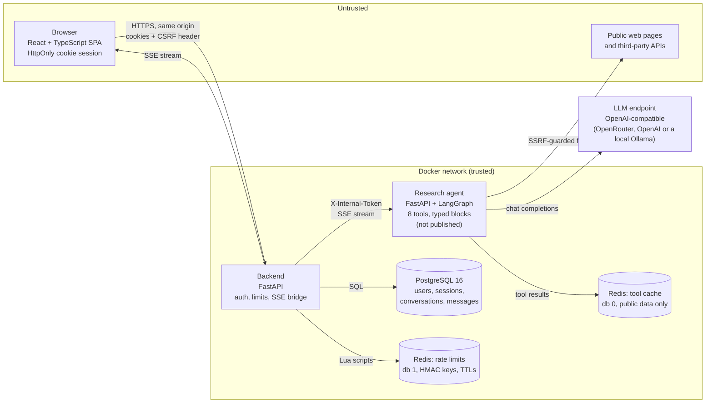
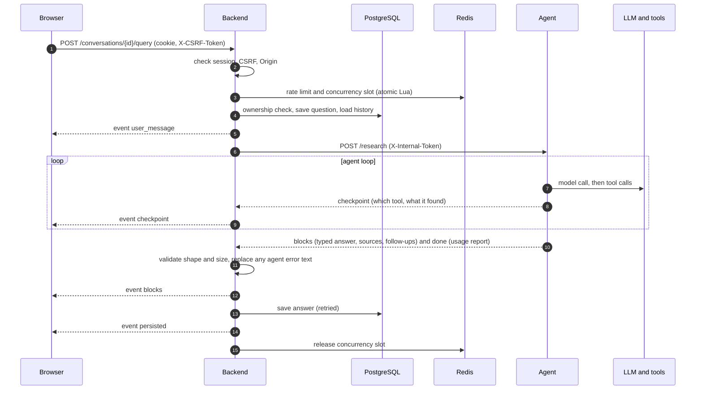
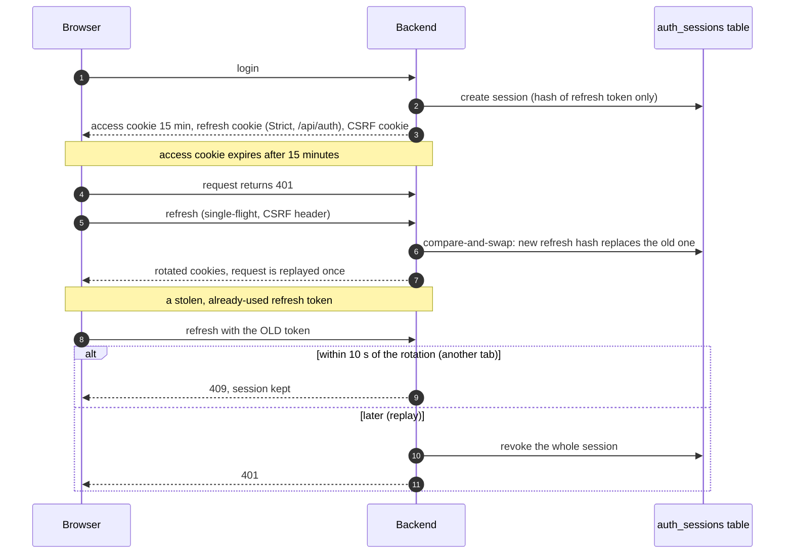
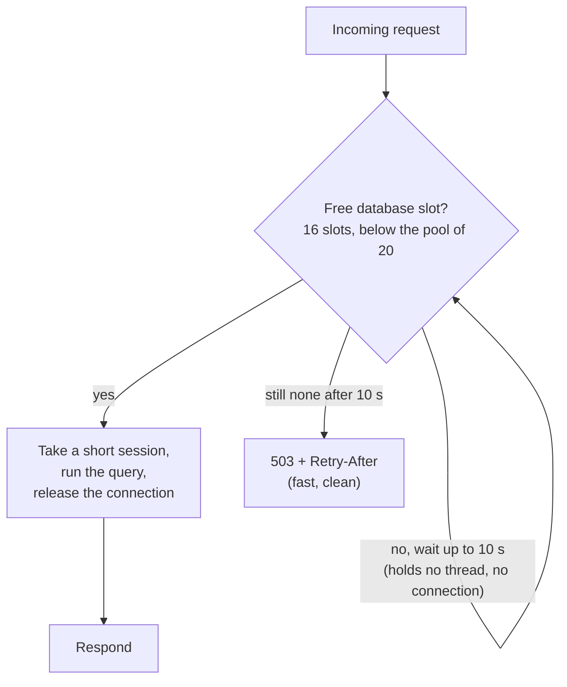
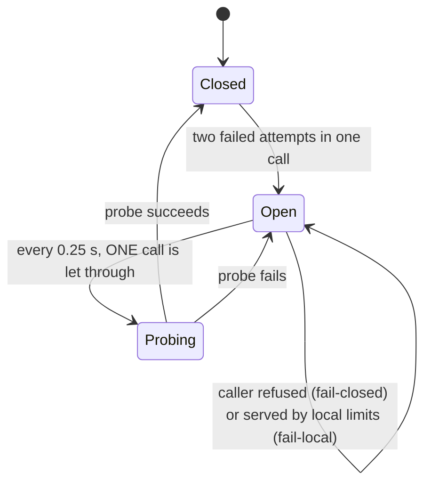
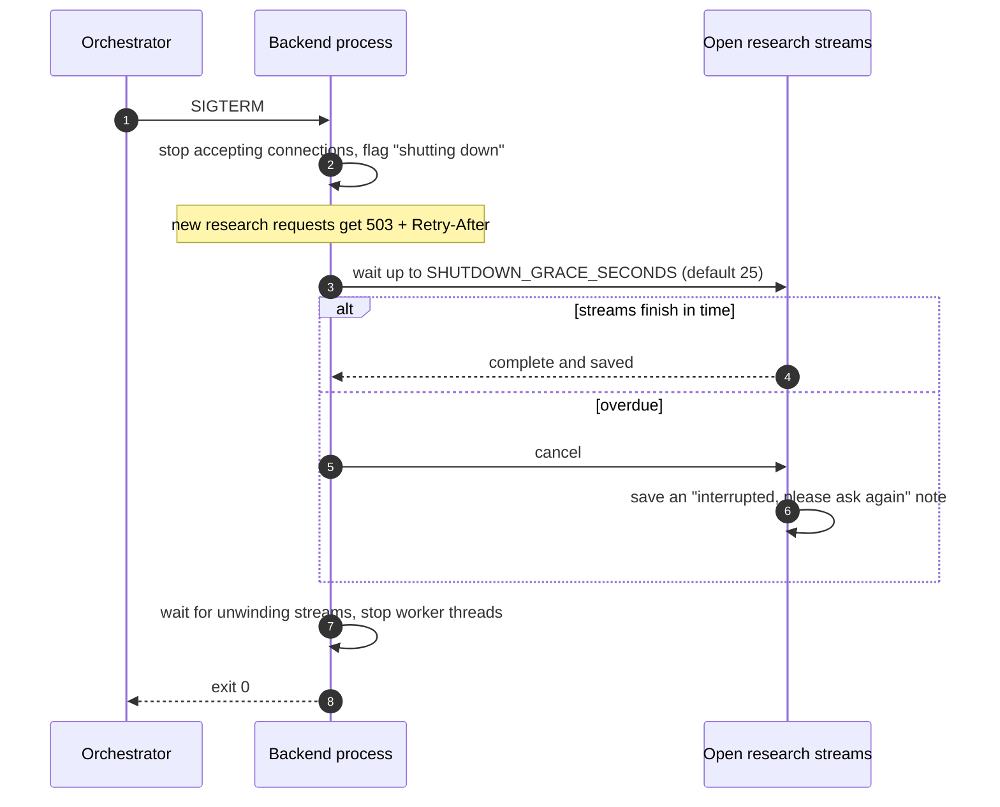
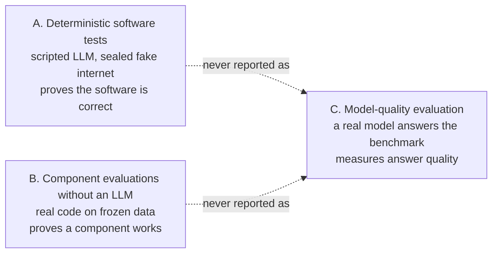

# Architecture diagrams

GitHub renders the Mermaid blocks below. Each diagram describes behaviour that exists in the code; where something is measured or tested, the document that holds the evidence is linked.
Text versions of the same material: [`../ARCHITECTURE.md`](../ARCHITECTURE.md), [`../research-agent/ARCHITECTURE.md`](../research-agent/ARCHITECTURE.md).

## 1. Components and trust boundaries

Rules at each boundary are listed in [`../ARCHITECTURE.md`](../ARCHITECTURE.md) section 1. The agent has no published port and rejects any request without the shared secret.

## 2. One research request

If the browser disconnects, the upstream agent request is cancelled; an answer that had already completed is still saved. Event payloads: [`API.md`](API.md).

## 3. Cookie session lifecycle

Idle expiry 24 h, absolute expiry 7 days, logout and logout-all revoke server-side. Ended sessions are purged after 7 days by `app/cleanup.py`. Tests: [`COOKIE_AUTH_MIGRATION_PLAN.md`](COOKIE_AUTH_MIGRATION_PLAN.md) section 14.

## 4. Why database admission is gated (found by load testing)

Before this, 50 concurrent researches failed (18 of 50 succeeded) because requests held one pooled connection while waiting for another, and every worker thread was blocked waiting on the pool: a hold-and-wait
deadlock that only the 30 s pool timeout ended. The measurements and the fix: [`PERFORMANCE.md`](PERFORMANCE.md) section 1.

## 5. Redis circuit breaker (half-open)

Before the probe, a 0.9 s Redis stall left a single user refused for 4.7 s after Redis was back. After it, none. [`PERFORMANCE.md`](PERFORMANCE.md) section 3a.

## 6. Shutdown (SIGTERM)

Without the waiting and the worker stop, the process hung until SIGKILL (exit 137) and every cut answer was lost. Measured results: [`PERFORMANCE.md`](PERFORMANCE.md) section 3.

## 7. What kind of evidence supports which claim

Status of each tier: [`ZERO_BUDGET_PLAN.md`](ZERO_BUDGET_PLAN.md). Tier C has **not** been run.
